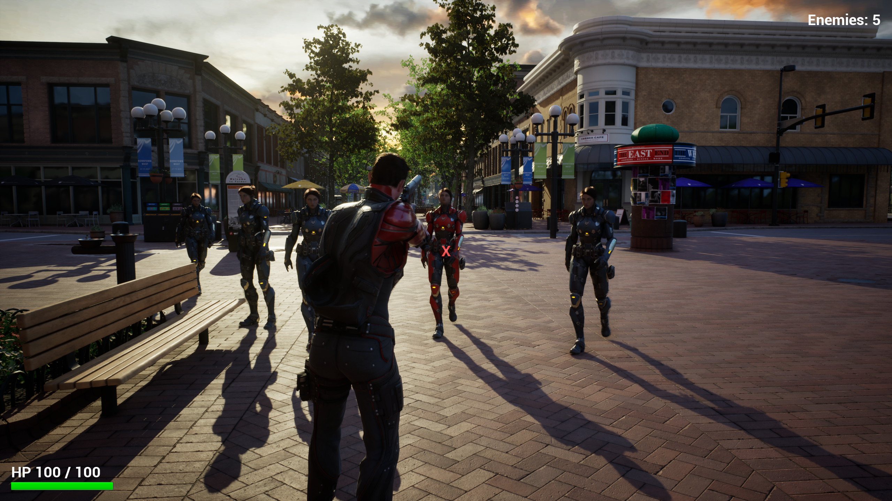
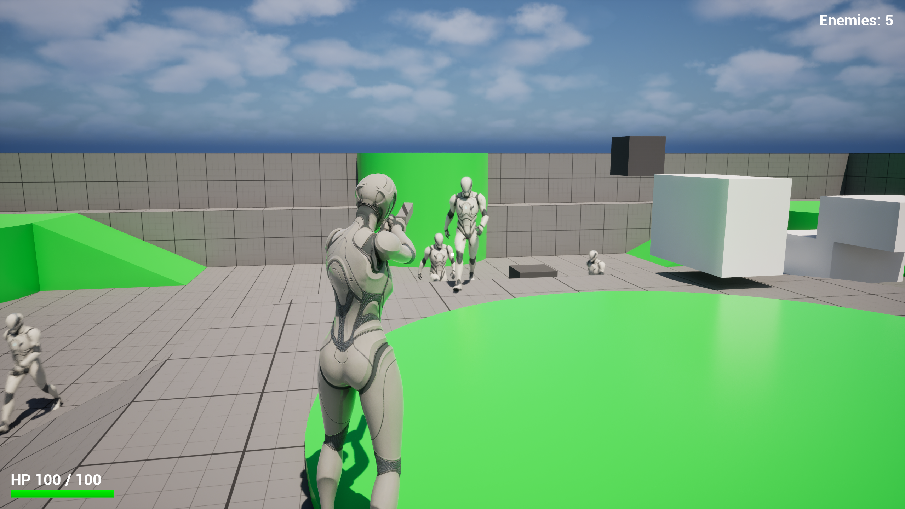
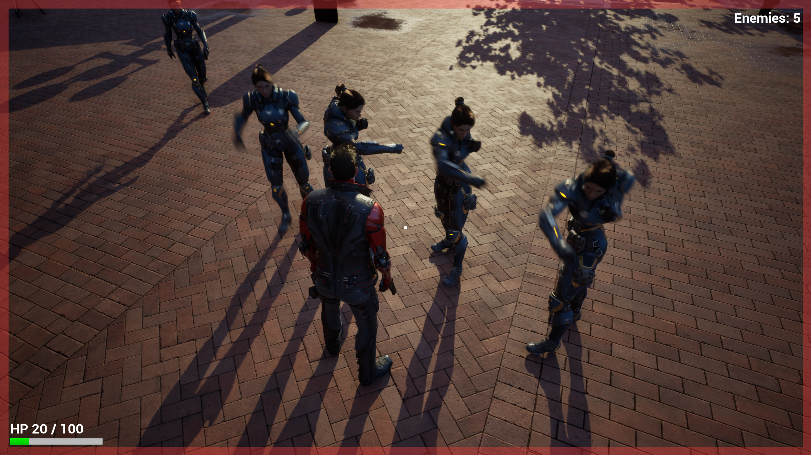
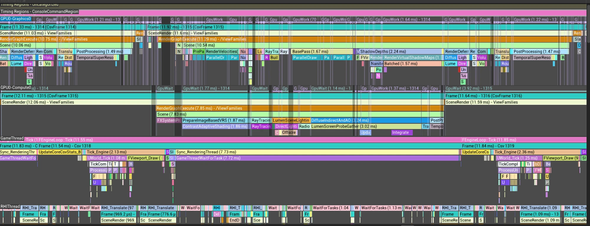
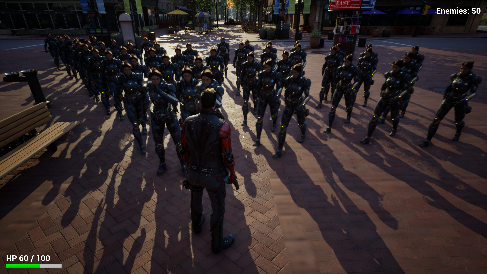

# UE5 TPS — 게임 제작부터 성능 분석까지

> **English summary.** A five-week solo project in Unreal Engine 5.8.2: a third-person shooter built in C++, finished as a packaged game, then extended with combat animation, external assets and a measurement-driven performance study. Because gameplay rules live in C++ and presentation in Blueprint, replacing every asset needed **no C++ changes**. Profiling with Unreal Insights led to one adopted optimization (−4.7% GPU at 50 enemies). Third-party assets are not included.

## 개요

UE5 C++로 3인칭 슈터를 정한 범위대로 패키지 실행까지 완성하고, 같은 게임에 전투 연출과 외부 에셋을 차례로 얹은 뒤, 패키지 빌드의 CPU·GPU 비용을 측정해 근거 있는 최적화까지 마친 개인 프로젝트입니다.

- **기간:** 약 5주
- **배경:** UE5 게임플레이·클라이언트 개발 흐름을 익히기 위한 연습 프로젝트로 시작했습니다.

| 단계 | 내용 |
|---|---|
| 첫 완성 | 이동·조준·사격, 체력과 피해, 적 AI 5명(추적·공격), 승패와 Restart, HUD, Windows 패키징 |
| 전투 연출 | 무기 부착, 조준 자세, 발사·공격·피격·사망 몽타주, 총구 효과, 개체별 피격 머티리얼 |
| 외부 에셋 연결 | 플레이어·적 모델 교체(리타기팅), 권총, 도심 환경, 새 맵의 내비게이션 |
| 성능 분석·최적화 | 기준 측정, 적 5/20/50명 확장, CPU·GPU 분리, RT 비용 개선, DLSS SR·RR, 품질 프리셋 비교 |

## 결과

- **정한 범위를 끝까지 완성했습니다.** 만들 것과 만들지 않을 것을 먼저 정하고, 전투 → 승패 → Restart가 반복되는 Windows 패키지까지 완성했습니다. 이후 단계도 매번 새 패키지로 다시 검증했습니다.
- **규칙과 표현을 나눈 구조가 끝까지 유지됐습니다.** 판정·체력·AI·승패는 C++, 표현은 C++이 알리는 이벤트를 Blueprint가 받아 처리합니다. 사격 판정 원점과 총구 효과를 분리했고, 사망은 피해 차단과 적 수 통지를 먼저 확정한 뒤 연출을 재생합니다. 그래서 플레이어·적·무기·환경을 모두 바꾼 단계에서 **C++ 변경은 0건**, 적을 50명으로 늘리고 최적화한 단계에서도 **한 줄**이었습니다(Git 이력 기준, Blueprint·애니메이션·맵 작업은 별도).
- **외부 에셋 통합 과정 전체를 거쳤습니다.** 애니메이션 리타기팅, 애니메이션 블루프린트와 몽타주, 무기 소켓, 개체별 머티리얼, 새 맵의 NavMesh와 장애물 우회, 쿠킹과 패키징.
- **완성한 게임을 측정하고 근거로 최적화했습니다.** 적 수 증가의 비용을 CPU·GPU와 패스 단위까지 나눠 적 메시의 레이 트레이싱 갱신을 줄이는 변경을 채택했고(적 50명 GPU −4.7%), 효과가 없거나 손해인 시도는 엔진 소스와 GPU 큐 구조로 원인을 확인하고 기각했습니다.

**의의:** UE 게임 제작의 흐름(C++ 게임플레이 → 에디터·Blueprint·애니메이션 → 에셋 통합 → 패키징 → 프로파일링)을 한 프로젝트로 거치며 각 단계를 플레이 가능한 패키지로 마무리했습니다. 처음 세운 역할 분리는 연출 추가, 에셋 전면 교체, 적 수 10배를 실제로 견뎠습니다. 마지막 단계에서는 "적 메시를 레이 트레이싱에 넣을 것인가" 같은 게임 쪽 결정이 엔진의 스키닝, RT 갱신, GPU 큐에서 어떤 비용이 되는지 끝까지 추적했습니다.

## 게임

- WASD 이동, 마우스 시점, Space 점프. 우클릭을 누른 채 조준하고 좌클릭으로 단발 사격합니다(무제한 탄약).
- 적 5명을 모두 처치하면 승리, 플레이어 체력이 0이면 패배합니다. 결과 화면의 Restart로 새 판을 시작합니다.
- HUD: 조준점과 발사·명중 표시, 체력과 피격 표시, 남은 적 수, 결과 화면.

| 전투 연출 단계 | 외부 에셋 연결 후 최종 빌드 |
|---|---|
|  |  |
| 템플릿 마네킹과 시험용 맵에서 사격·체력·적 AI·연출을 먼저 완성 | 같은 게임 규칙 위에 캐릭터·무기·환경만 교체. 피격 시 화면 가장자리와 체력 바로 표시 |

## 코드 구조

전투 판정과 게임 규칙은 C++, 에셋 연결·수치 조정·UI·짧은 연출은 Blueprint가 맡습니다. Blueprint와 맵은 서드파티 에셋을 참조하므로 이 저장소에 포함하지 않았습니다.

| 클래스 (`miniTPS/Source/miniTPS/`) | 역할 |
|---|---|
| `miniTPSCharacter` | 템플릿 캐릭터를 확장. 조준 상태, 발사 간격, 사격 판정(카메라 trace로 조준점을 정하고 총구 쪽 `ShotOrigin`에서 다시 trace, 원점이 벽에 막히는 경우 차단), 체력·피해·사망 |
| `EnemyAIController` | 0.5초 타이머로 추적 갱신, 시야 trace, 사거리 안에서 일정 간격 공격, 이동 실패 기록 |
| `EnemyCharacter` | 적 체력과 피해, 공격·피격·사망 연출 호출, 사망 후 정리. 레이 트레이싱 제외 설정(성능 분석에서 채택) |
| `miniTPSGameMode` | 남은 적 수 관리, 승패 확정(한 번만), 전투 종료 통지 |
| `miniTPSPlayerController` | C++ 상태 변화를 UI 이벤트(결과, 명중, 발사, 피격)로 전달 |
| `TargetDummy` | 사격 판정 시험용 표적 |

`Variant_Combat`, `Variant_Platforming`, `Variant_SideScrolling` 폴더는 Third Person 템플릿이 생성한 코드로, 수정하지 않았습니다.

## 성능 분석 (마지막 단계)

완성한 게임을 패키지 실행 기준으로 측정해 병목을 찾고 개선했습니다. **분석 결과를 하나로 묶는 관찰: GPU의 그래픽 큐가 프레임의 임계 경로이고, 비동기 컴퓨트 큐에는 약 4 ms 여유가 있습니다.** 그래서 비동기 컴퓨트 쪽 절감은 프레임 시간에 전달되지 않고 그래픽 큐 쪽 절감만 전달되며, 아래 채택·기각 결과가 모두 이것으로 설명됩니다.

*위 `GPU0-Graphics0`은 프레임 내내 작업하고, 아래 `GPU0-Compute0`은 Lumen GI 등을 처리한 뒤 프레임 끝에서 약 3.9 ms 기다립니다.*

환경: i5-14600K, RTX 4070 Ti SUPER, 2560×1440 출력(TSR 내부 60.6%), Lumen 하드웨어 RT, 품질 Epic. 기준 장면은 GPU 약 12 ms로 GPU 병목입니다. 적 수에 따른 비용은 적 5·20·50명 맵으로 비교했습니다.

| 질문 | 결과 |
|---|---|
| 적이 5 → 20 → 50명으로 늘면 무엇이 늘어나나 | CPU: 캐릭터 이동이 1명당 0.025 ms로 선형이지만 50명에서도 GameThread(약 6.5 ms) < GPU. GPU: 증가분 +1.36 ms의 약 70%가 적 스키닝 메시의 RT 동적 지오메트리 갱신 |
| RT에만 낮은 LOD를 쓰면 | **기각.** 오히려 Frame +0.32 ms. 엔진 소스(`SkeletalRenderGPUSkin.cpp`)에서 RT LOD가 화면 LOD와 다르면 RT용 스키닝을 한 번 더 한다는 원인 확인 |
| 적 메시만 RT에서 빼면 | **채택.** 적 50명 GPU −0.65 ms(−4.7%), Frame −0.48 ms. 대가: 유리 반사에 적이 비치지 않음 |
| 비동기 큐의 VRS 이미지 패스(2.1 ms)를 끄면 | 효과 없음. 비동기 큐에서 겹쳐 돌아 프레임 비용이 아니었음 |
| DLSS SR | UE 5.8.2 프로젝트 플러그인으로 동작. 같은 내부 해상도에서는 TSR과 동급, 50% 해상도에서는 −3.5% |
| DLSS RR | +7.5% 비용. 밝고 세밀한 반사가 더 선명해지는 화질 옵션 |
| 품질 프리셋을 낮추면 | Epic 대비 GPU: High −9%, Medium −24%. 해상도를 32% 낮췄을 때(−3.8%)보다 효과가 큼 |

- **분석 요약:** [docs/performance/summary.md](docs/performance/summary.md)
- 회차별 원본 수치와 측정 기록은 이 저장소에 포함하지 않았습니다.

### 측정 방법과 도구

- 에디터가 아니라 Windows Development 패키지를 자동 실행합니다. 15초 워밍업 뒤 8초 동안 좌우 이동을 자동 입력하고, 무적·사격 없음으로 조건을 고정했습니다.
- CSV 프로파일러와 Unreal Insights trace(trace 서버 방식)를 같은 8초 구간에서 기록하고, GPU 스코프를 큐별 점유·대기 시간으로 집계합니다.
- 기준 → 변경 → 변경 → 기준처럼 교차 실행하고 묶음의 첫 회차는 버립니다. 바뀌지 않아야 할 패스를 대조로 둡니다.
- 회차마다 설정의 실제 값과 출처, 실제 업스케일러와 내부 해상도를 다시 읽어 다르면 측정 전에 멈춥니다. 이 검사로 게임이 종료할 때 품질 설정을 저장해 다음 기준 회차가 다른 단계로 시작하던 문제 등을 잡았습니다.
- 실행·입력·수집·집계를 자동화한 측정 스크립트는 AI 도구로 작성해 사용했고, 이 저장소에는 포함하지 않았습니다.

## 이 저장소에 없는 것

이 저장소는 코드·설정·측정 도구·분석 문서만 담습니다. **`miniTPS/Content/`와 DLSS 플러그인이 없으므로 그대로는 프로젝트가 열리지 않습니다.**

| 항목 | 출처 |
|---|---|
| 플레이어 모델 | [Paragon: Twinblast — Epic Games (Fab)](https://www.fab.com/listings/9fa88852-5711-42e1-94fa-2491498a64da) |
| 적 모델 | [Paragon: Lt. Belica — Epic Games (Fab)](https://www.fab.com/listings/6f3a45fb-b5fe-4866-9a60-de315301f75b) |
| 권총 | [M1911 (FREE) — Xeradev (Fab)](https://www.fab.com/listings/77247d26-33a3-4dba-a840-7a7d8c92bb9c) |
| 환경 | [Downtown West Modular Pack — PurePolygons (Fab)](https://www.fab.com/listings/0faf8b5d-7a5f-4fee-a297-7a8efaba8896) |
| 템플릿 콘텐츠 | UE 5.8 Third Person 템플릿 |
| DLSS | NVIDIA DLSS 4.5 UE 5.8 플러그인 8.9.0(`miniTPS/Plugins/DLSS`, `StreamlineNGXCommon`) |

직접 만든 Blueprint, UI 위젯, 애니메이션 블루프린트와 몽타주 연결, 맵 배치와 내비게이션 설정도 위 에셋을 참조하는 바이너리 파일이라 함께 제외했습니다.

## 한계

- 성능 수치는 대부분 trace를 켠 상태이고 조건별 2회·8초 표본입니다. 같은 묶음 안의 차이만 비교했습니다.
- 측정은 한 대의 PC(RTX 4070 Ti SUPER) 기준입니다. 보급형 GPU의 실제 프레임은 측정하지 않았습니다.
- trace를 켠 실행은 종료 코드 777003으로 끝납니다(데이터는 정상 분석). 원인은 조사하지 않았습니다.
- 그 밖의 한계와 다음 과제는 [summary.md](docs/performance/summary.md)에 있습니다.

## AI 도구 사용

설계, 실험 선택과 판단, 에디터 작업, 플레이와 화질 확인은 직접 했습니다. 코드 구현과 측정·분석 스크립트 작성, 문서 정리에는 AI 코딩 도구(OpenAI Codex, Anthropic Claude Code)를 활용했습니다.

## 라이선스

포트폴리오 열람용 저장소입니다. 오픈소스 라이선스를 붙이지 않았습니다. Third Person 템플릿에서 생성된 코드는 Unreal Engine EULA를 따릅니다.
